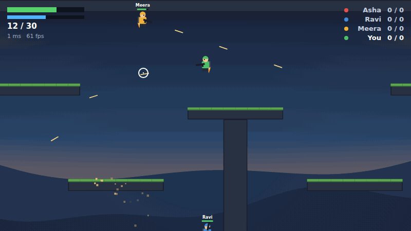
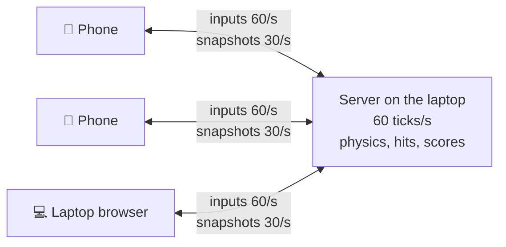
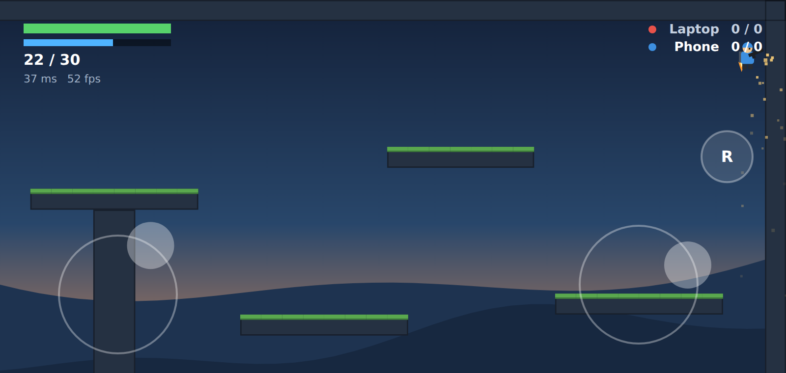
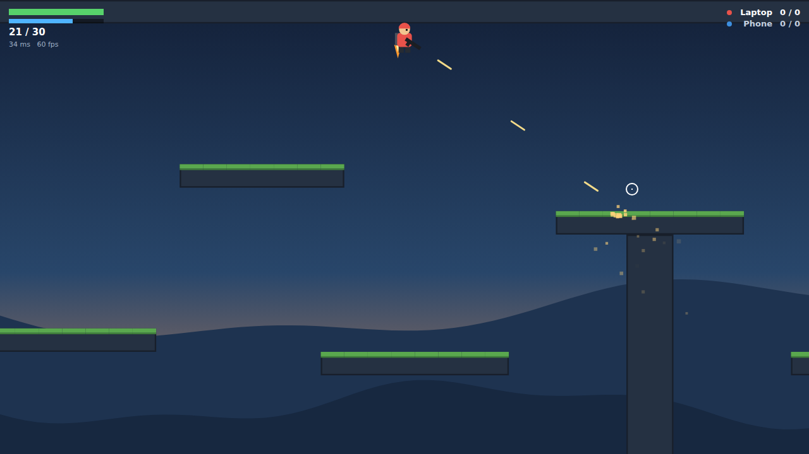

<div align="center">

# LAN Militia

**A 2D jetpack shooter for friends on the same Wi-Fi.**
One laptop hosts. Everyone else plays in their phone's browser. No app, no account, no internet.

[](https://github.com/sainad2222/lan-militia/actions/workflows/ci.yml)
[](LICENSE)




</div>

## Quick start

```sh
git clone https://github.com/sainad2222/lan-militia.git
cd lan-militia
npm install
npm start
```

```
LAN Militia is running.

Phones on the same Wi-Fi join at:  http://192.168.1.23:8080

  ▄▄▄▄▄▄▄ ▄ ▄▄ ▄▄▄▄▄▄▄
  █ ▄▄▄ █ ▀█▄█ █ ▄▄▄ █      <- scan with a phone camera
  █ ███ █ ▄▀ ▀ █ ███ █
  ...
On this laptop:  http://localhost:8080
```

Scan, type a name, tap **Play**. Up to 8 players.

> No Git or npm? Grab the zip from [Releases](https://github.com/sainad2222/lan-militia/releases), unzip, and run `node dist/server.js`. Only [Node.js 22+](https://nodejs.org) is needed.

## How it fits together



The server also serves the game page, so phones need nothing installed. Use the same Wi-Fi router or one phone's hotspot. Nothing leaves your network.

## Controls

| | 📱 Phone | 💻 Laptop |
|---|---|---|
| Move | Left thumb ↔ | `A` `D` |
| Fly | Left thumb ↑ | `W` or `Space` |
| Aim | Right thumb | Mouse |
| Shoot | Right thumb, push far | Click |
| Reload | **R** button | `R` |

| Phone | Laptop |
|---|---|
|  |  |

## Why it feels responsive

| Technique | What you notice |
|---|---|
| **Client prediction**: your phone runs the same physics as the server ([`sim.ts`](src/shared/sim.ts)) | Your player moves the instant you touch |
| **Reconciliation**: server updates are replayed against unconfirmed inputs | No rubber-banding; tests confirm the phone and server agree exactly |
| **Interpolation**: other players drawn ~80 ms behind, blended between updates | Smooth movement through Wi-Fi jitter |
| **Server authority**: the laptop decides hits and deaths | No arguments about who shot first |

Ping and FPS are shown under the ammo count. Details in [docs/architecture.md](docs/architecture.md).

## Configuration

| Variable | Default | |
|---|---|---|
| `PORT` | `8080` | `PORT=9000 npm start` |

Game tuning (gravity, fuel, fire rate, damage) lives in [`src/shared/constants.ts`](src/shared/constants.ts). The map is a list of rectangles in [`src/shared/map.ts`](src/shared/map.ts).

## FAQ

<details>
<summary><b>Phones can't open the link</b></summary>

- Laptop and phones must be on the **same network**. A phone hotspot works: everyone, including the laptop, joins it.
- Guest, office and campus Wi-Fi often block devices from reaching each other. Use a home router or a hotspot.
- **Windows:** allow Node.js when the firewall asks, and set the Wi-Fi network to *Private*.
- **macOS:** click *Allow* when asked about incoming connections.
- If several addresses are printed, try the others.
</details>

<details>
<summary><b>Can a phone be the host instead of a laptop?</b></summary>

Not yet. A browser can't run a server, so the host needs Node.js. On Android, [Termux](https://termux.dev) with `pkg install nodejs` works for experiments.
</details>

<details>
<summary><b>The browser bar takes up space on iPhone</b></summary>

iPhone Safari doesn't allow full screen for web pages. Use **Share → Add to Home Screen** and open it from there for a full-screen view. Android Chrome goes full screen when you tap Play.
</details>

<details>
<summary><b>Is it safe to run?</b></summary>

The server only serves the game files and accepts game messages. There are no accounts or passwords, so anyone on the same network can join. Don't expose it to the internet. See [SECURITY.md](SECURITY.md).
</details>

## Contributing

Bug reports, maps, weapons and ideas are all welcome. See [CONTRIBUTING.md](CONTRIBUTING.md).

```sh
npm test         # unit + live-server tests
npm run typecheck
```

## License

[Apache 2.0](LICENSE)

LAN Militia is a fan project inspired by Mini Militia. It is not affiliated with or endorsed by the makers of Mini Militia, and uses none of its code, art, sound or maps.
