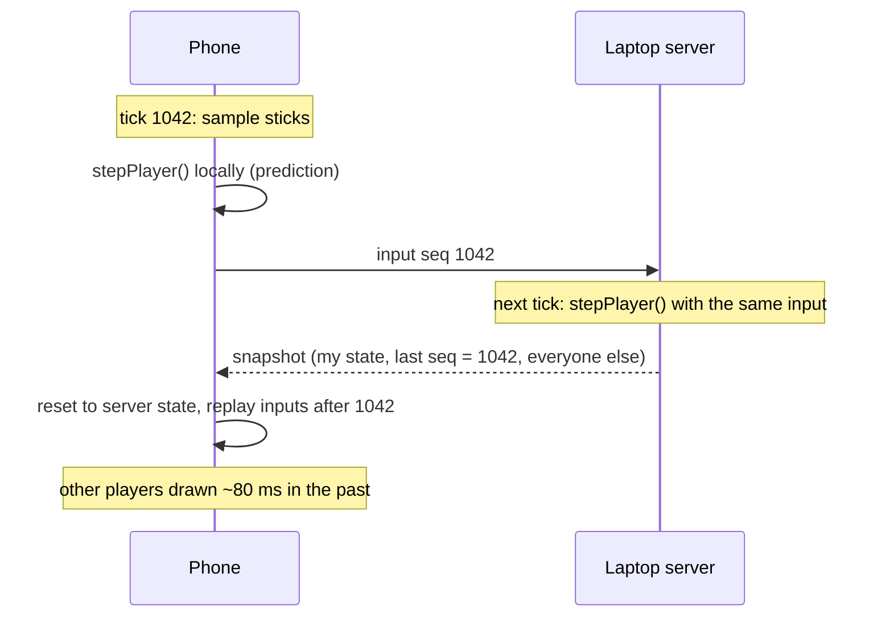

# Architecture

## Layout

```
src/shared/    used by both sides
  constants.ts   tick rate, physics and weapon tuning
  map.ts         map rectangles, spawn points, collision queries
  sim.ts         player physics, gun, bullets (deterministic)
  protocol.ts    message types
src/server/
  game.ts        authoritative game state, damage, respawns, snapshots
  main.ts        HTTP + WebSocket server, fixed-rate loop, QR code
src/client/
  main.ts        connection, prediction, reconciliation, frame loop
  controls.ts    touch sticks, keyboard, mouse
  snapshots.ts   snapshot buffer and server clock estimate
  render.ts      canvas drawing and HUD
tests/           node:test suites (sim, game, live server)
```

## One input, end to end



## Rules that keep it working

- **`sim.ts` must stay deterministic.** The client and server both run `stepPlayer()` on the same inputs and expect identical results. No `Math.random()`, wall-clock time or frame-rate dependent math inside it. Timers are counted in ticks, not seconds.
- **One input = one tick.** The client sends one input per 1/60 s. The server processes queued inputs in order (up to 4 per tick, so bursts from Wi-Fi hiccups are caught up), and acknowledges the last one in each snapshot.
- **The server decides hits.** The client draws its own bullets immediately for feel, but only server events change health and scores.

## Numbers

| | Value | Where |
|---|---|---|
| Server tick | 60 Hz | `TICK_RATE` |
| Snapshots | 30 Hz | `SNAPSHOT_EVERY` |
| Interpolation delay | 5 ticks (~83 ms) | `INTERP_TICKS` |
| Players | 8 | `MAX_PLAYERS` |
| Bandwidth | ~2 KB per snapshot with 8 players | JSON |

## Ideas for later

- Lag compensation for hits (rewind targets to what the shooter saw)
- WebRTC data channels to avoid TCP head-of-line stalls on lossy Wi-Fi
- Binary snapshots
